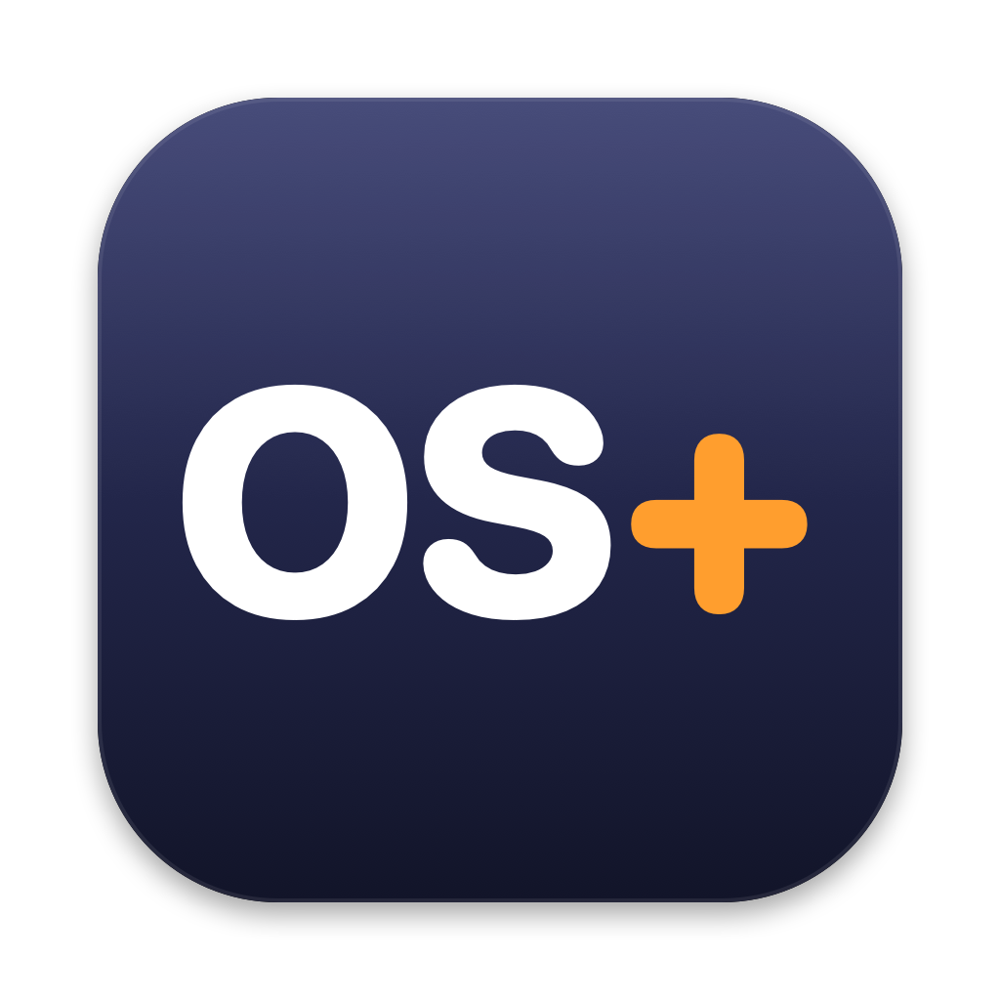
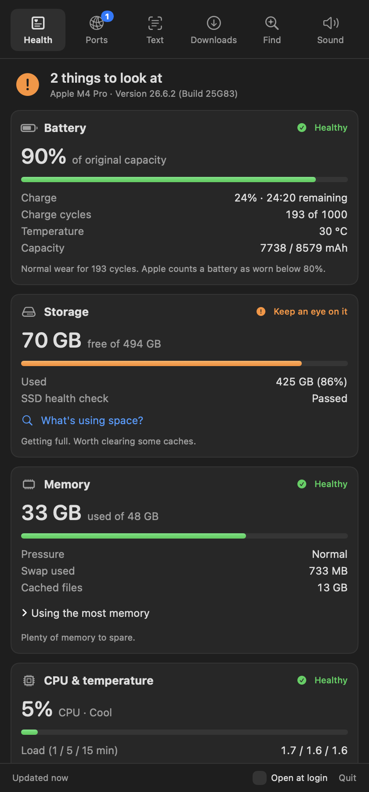
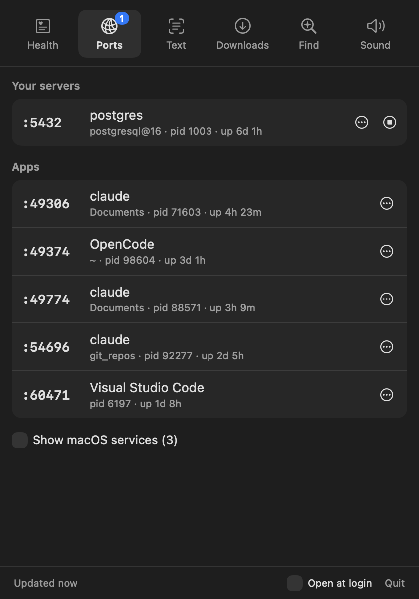
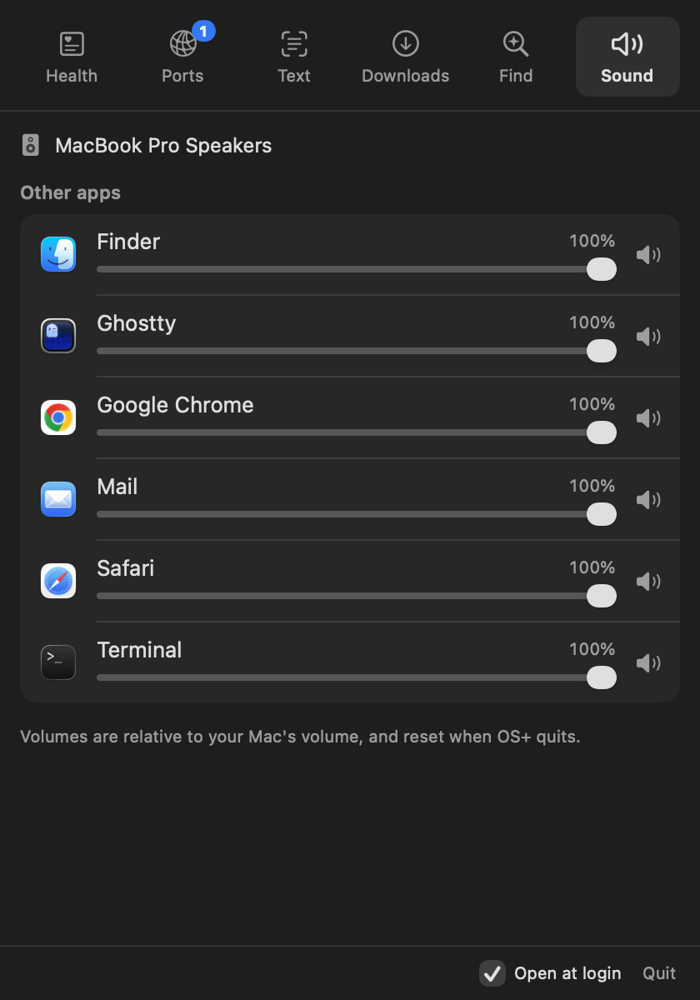

<p align="center">
  
</p>

<h1 align="center">OS+</h1>

<p align="center">
  <b>The extras macOS should have shipped with.</b><br>
  One menu-bar icon: Mac health, dev ports, screen text grabbing, Downloads cleanup, fuzzy file search and per-app volume.
</p>

<p align="center">
  <a href="../../actions/workflows/ci.yml"></a>
  
  
  
  
</p>

<p align="center">
  
  
  
</p>

## What's inside

| | Tab | What it does |
|---|---|---|
| 🩺 | **Health** | Battery wear and cycles, storage and SSD health, memory pressure, CPU and heat, Time Machine, uptime. Each area gets a clear *healthy / keep an eye on it / needs attention* verdict. **What's using space?** finds caches and old `node_modules` that are safe to bin. |
| 🌐 | **Ports** | What's listening on localhost, which project started it and how long ago, with Open / Stop / Show Folder. Your servers are kept separate from apps and macOS services. |
| 🔤 | **Text** | Press **⌘⇧2** anywhere, drag a box over a video, image, dialog or slide, and the text (English and Spanish) or QR code is on your clipboard. On-device OCR. |
| 📥 | **Downloads** | Newest first, with the site each file came from. Rename, move, or bin with Undo. Filters for old files, installers and byte-identical duplicates. |
| 🔎 | **Find** | Press **⌘⇧Space** anywhere. Typos are fine (`stava`), initials work (`sfa`), and you can describe it: `lease pdf from last spring`. Apple's on-device model suggests other words file names might use. |
| 🔊 | **Sound** | A volume slider and mute per app (turn Spotify down on a call). Uses Apple's own audio taps: no drivers, no `sudo`, and quitting puts every app back to normal. |

## Principles

- **Local only.** No network calls, analytics or accounts. AI features use Apple's on-device model.
- **Nothing is ever deleted.** Clean-ups go to the Trash, and every one is confirmed or undoable.
- **Never surprising.** Processes stop only when you click. No kernel extensions, audio drivers or root helpers.

## Install (from source)

Requires an Apple silicon Mac on **macOS 26** and **Xcode 26** (Swift 6.2).

```sh
git clone https://github.com/AliSakanak/os-plus.git
cd os-plus
scripts/build-app.sh      # builds, signs locally, installs /Applications/OS+.app and launches it
```

The app is ad-hoc signed for local use. On first use macOS will ask for **Screen Recording** (Text),
**System Audio Recording Only** (Sound) and access to your **Downloads/Documents** folders.

## Shortcuts

| Shortcut | Action |
|---|---|
| **⌘⇧2** | Grab text from the screen (change it in the Text tab) |
| **⌘⇧Space** | Open the file finder (change it in the Find tab) |
| **↩ / ⌘↩ / ⌘C** | In the finder: open, show in Finder, copy path |

## How it's built

```
Sources/
  WorkbenchCore/     all logic: readers, parsers, search, verdicts. No UI, unit-tested.
  WorkbenchAudioRT/  real-time audio in C (no allocation or locks on the audio thread).
  Workbench/         SwiftUI menu-bar app: one model + view per tab.
Tests/               Swift Testing suites, using fixtures from real Macs.
scripts/             build-app.sh, make-icon.sh, sound-selftest.sh
```

"Workbench" is the project's code name, so that's what the Swift targets are called. The bundle id stays
`local.workbench` so permissions survive updates.

## Contributing

Issues and pull requests are welcome. See [CONTRIBUTING.md](CONTRIBUTING.md) for setup, debug flags and the ground rules.

## License

[MIT](LICENSE)
